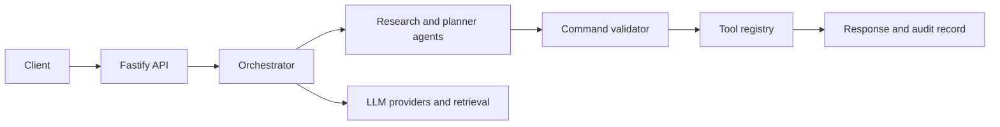

<div align="center">
  

  <a href="https://readme-typing-svg.demolab.com"></a>

  <p>
    
    
    
    <a href="LICENSE"></a>
  </p>
</div>

## 🐧 What it does

Orito is a backend for a Linux assistant. It classifies a request, gathers context, plans work, validates command safety, and returns a response through a Fastify API. This repository contains the backend; it does not include a finished desktop client.

## 🔁 Request path



## 🧩 Building blocks

- Specialist agents cover planning, research, validation, synthesis, and system context.
- Registered tools include web search, package lookup, man-page retrieval, calculations, and command-safety checks.
- OpenRouter and Gemini are configured as model providers; SearXNG/Tavily and Pinecone/Qdrant settings are present for search and retrieval integrations.
- Firebase authentication, JWT sessions, MongoDB persistence, WebSocket streaming, and audit logging are implemented in the backend.

Commands are proposed and validated by the application. Review any command before running it on a real machine; an assistant is not a substitute for an operator's judgment.

## 🧰 Stack

| Area | Tools |
|---|---|
| Runtime/API | Node.js 20+, TypeScript, Fastify |
| Auth | Firebase Admin, JWT |
| Data | MongoDB/Mongoose |
| Models | OpenRouter SDK, Google Gemini |
| Search/retrieval | SearXNG/Tavily, Pinecone or Qdrant configuration |
| Realtime/logging | WebSockets, Pino |

## 🚀 Run the backend

```bash
git clone https://github.com/ChristopherJoshy/Orito.git
cd orito/backend
npm ci
cp .env.example .env
npm run dev
```

On Windows PowerShell, copy the example with `Copy-Item .env.example .env`. Fill in only the providers you intend to use. MongoDB is required for persistence; the optional integrations need their own services and credentials.

Useful scripts:

```bash
npm run build
npm test
```

## 🗂️ Layout

```text
backend/src/agents/   orchestration and specialist agents
backend/src/tools/    registered tool implementations
backend/src/routes/   HTTP and WebSocket endpoints
backend/src/models/   persisted domain models
```

## 📄 License

MIT. See [`LICENSE`](LICENSE).

## ⚠️ Notes

The repository is backend-only. Provider credentials, Firebase service-account files, and production infrastructure are not included.